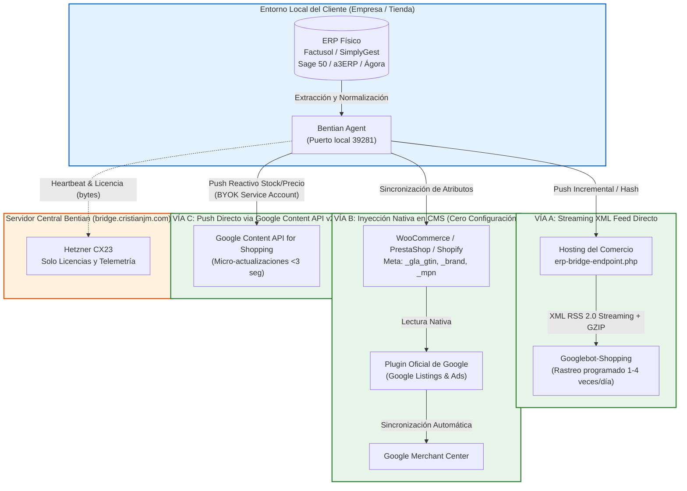

# Bentian ERP Bridge & Google Merchant Center: Especificación Modular
## Sección 3: Arquitectura Técnica de las Tres Vías de Integración

> **ESTADO:** Aprobado / Especificación de Arquitectura Modular  
> **FECHA:** 31 de Octubre de 2026  
> **ÁMBITO:** Arquitectura de Datos, Protocolos XML/REST/API, Streaming y Coste Cero  
> **UBICACIÓN MODULAR:** `docs/architecture/google-merchant/`

---

### 3.1. Visión General de las Tres Vías Arquitectónicas

Bentian ERP Bridge ofrece **tres vías arquitectónicas complementarias** para conectar el catálogo del ERP con Google Merchant Center, adaptándose a cualquier casuística técnica, volumen de catálogo o infraestructura existente:



---

### 3.2. Vía A: Streaming XML Feed Directo (Hosting del Comercio)

Diseñada para tiendas que no desean instalar extensiones de terceros o plataformas con desarrollo a medida.

#### Características Técnicas:
1. **Generación por Streaming (Bajo Consumo de RAM):**
   - El archivo XML no se construye en memoria como una cadena gigante de 200 MB.
   - Se sirve directamente desde `erp-bridge-endpoint.php` en el hosting del cliente mediante un bucle de lectura de base de datos o almacenamiento local con compresión GZIP (`ob_gzhandler` o `gzencode`).
   - Soporta catálogos de más de 50.000 referencias con menos de 32 MB de memoria PHP asignada.
2. **Cabeceras HTTP de Caché Inteligente:**
   - Devuelve `Last-Modified` y `ETag` basados en la última fecha de sincronización del ERP.
   - Si Googlebot realiza una comprobación y no ha habido ventas físicas, el endpoint responde inmediatamente con `304 Not Modified`, ahorrando el 100% de CPU y ancho de banda en el hosting.
3. **URL Canónica de Acceso Seguro:**
   `https://www.tudominio.com/erp-bridge-endpoint.php?action=google_merchant_feed&token=...`

#### Estructura Oficial XML RSS 2.0 / Google Base Namespace:
```xml
<?xml version="1.0" encoding="UTF-8"?>
<rss version="2.0" xmlns:g="http://base.google.com/ns/1.0">
  <channel>
    <title>Catálogo Oficial Suministros Rubio</title>
    <link>https://www.suministrosrubio.com</link>
    <description>Sincronización en Tiempo Real desde Factusol vía Bentian ERP Bridge</description>
    <item>
      <g:id>ART-01042</g:id>
      <g:title>BOSCH Taladro Percutor GSB 18V-55 Brushless</g:title>
      <g:description>Taladro percutor a batería con motor sin escobillas. Par de apriete 55 Nm.</g:description>
      <g:link>https://www.suministrosrubio.com/articulos/bosch-taladro-percutor-gsb-18v-55</g:link>
      <g:image_link>https://www.suministrosrubio.com/images/articulos/ART-01042.jpg</g:image_link>
      <g:availability>in_stock</g:availability>
      <g:price>159.00 EUR</g:price>
      <g:brand>BOSCH</g:brand>
      <g:gtin>3165140952873</g:gtin>
      <g:identifier_exists>yes</g:identifier_exists>
      <g:condition>new</g:condition>
      <g:product_type>Herramientas &gt; Electroportátil &gt; Taladros</g:product_type>
    </item>
  </channel>
</rss>
```

---

### 3.3. Vía B: Inyección Nativa de Metadatos en CMS (La Vía Más Fácil y Recomendada)

La inmensa mayoría de tiendas en España (WooCommerce, PrestaShop, Shopify) ya tienen instalada o pueden instalar la extensión oficial y gratuita desarrollada por Google:
* **WooCommerce:** *Google Listings & Ads* (oficial de WooCommerce y Google).
* **PrestaShop:** *Google Marketing Platform* (oficial).

#### El Problema Típico del Comerciante:
El plugin oficial de Google está instalado, pero el 80% de los productos aparecen rechazados con errores: *"Falta el valor GTIN"*, *"Falta la marca"*, o *"Disponibilidad incorrecta"*, porque WooCommerce y PrestaShop no tienen campos nativos de EAN integrados con el TPV del almacén.

#### La Solución Bentian:
Bentian **NO sustituye el plugin de Google**; lo alimenta con datos 100% limpios y verificados:
1. En **WooCommerce**, Bentian inyecta en cada producto sincronizado:
   - `_gla_gtin`: El código EAN-13 verificado del ERP.
   - `_brand`: La marca comercial extraída de Factusol / SimplyGest.
   - `_mpn`: La referencia del fabricante.
   - `_manage_stock` y `_stock`: El stock disponible exacto (`DISSTO`).
2. El plugin oficial de Google detecta los metadatos de inmediato y aprueba las fichas en Merchant Center sin que el usuario tenga que introducir ni un solo código a mano.

---

### 3.4. Vía C: Push Directo via Google Content API for Shopping v2.1 (BYOK)

Para catálogos grandes (>10.000 referencias) o empresas con alta rotación física que no pueden permitirse esperar al rastreo periódico del feed XML:

1. **Protocolo:** REST HTTPS a `https://shoppingcontent.googleapis.com/content/v2.1/{merchantId}/products/custombatch`.
2. **Micro-Actualizaciones Reactivas:**
   - Permite enviar únicamente los campos alterados (`availability` y `price`) en lotes atómicos de hasta 1.000 artículos en una sola llamada.
   - Latencia de propagación en Google Shopping: **menos de 3 segundos**.
3. **Seguridad y Cero Coste (BYOK):**
   - El comerciante utiliza su propia Cuenta de Servicio (*Google Service Account*) creada en Google Cloud Platform (gratuita).
   - El archivo de clave privada JSON se guarda localmente en el PC del cliente dentro de `%APPDATA%\Bentian Agent\`.
   - **El servidor central de Bentian jamás almacena credenciales de Google ni procesa llamadas API de terceros.**
