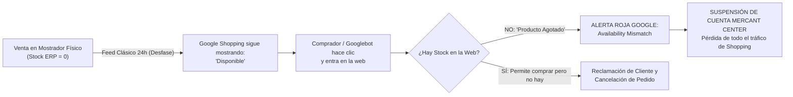

# Bentian ERP Bridge & Google Merchant Center: Especificación Modular
## Sección 4: Bentian Shield (Prevención Activa de Suspensiones de Cuenta)

> **ESTADO:** Aprobado / Especificación de Arquitectura Modular  
> **FECHA:** 31 de Octubre de 2026  
> **ÁMBITO:** Blindaje de Cuenta Merchant Center, Auditoría de Stock en Tiempo Real, Paridad Fiscal  
> **UBICACIÓN MODULAR:** `docs/architecture/google-merchant/`

---

### 4.1. La Amenaza Crítica: Por Qué Google Suspende Cuentas en España

Google Merchant Center emplea sistemas automáticos de rastreo continuo (**Googlebot-Shopping**) que navegan de forma invisible por las tiendas online fingiendo ser compradores reales. 

Si el robot detecta una sola discrepancia grave entre lo que dice el catálogo y lo que ve en la página web, el algoritmo activa una **Advertencia de Cuenta de 7 a 28 días** o, en casos reincidentes, una **Suspensión Definitiva del Dominio**:

---

### 4.2. Los 4 Pilares de Bentian Shield

Para erradicar de raíz el riesgo de suspensión, Bentian incorpora el subsistema **Bentian Shield**, compuesto por cuatro barreras defensivas automáticas:

#### Pilar 1: Sincronización Reactiva Prioritaria (Anti Availability Mismatch)
* **Monitoreo en Tiempo Real:** Bentian Agent detecta cambios en las tablas de stock físico (`F_ART` en Factusol, `ARTICULO` en SimplyGest) mediante escucha de transacciones.
* **Disparo Prioritario Inmediato:** Cuando el stock disponible de un artículo desciende a cero (`DISSTO <= 0`):
  1. Bentian **NO espera** al siguiente ciclo de sincronización masiva.
  2. Dispara una micro-llamada prioritaria a la tienda online (`erp-bridge-endpoint.php` o API WooCommerce) en **menos de 5 segundos**, marcando el producto como agotado (`out_of_stock`).
  3. Si está configurada la Vía C (Content API), notifica inmediatamente a Google Merchant Center para retirar el anuncio en tiempo récord.

#### Pilar 2: Cuadre de IVA al Céntimo (Anti Price Mismatch)
* **La trampa del IVA:** La mayoría de ERPs almacenan el precio de coste y el precio base sin IVA (`PRELTA = 12.3456 €`). Al aplicar el 21% de IVA:
  - Un cálculo ingenuo en JavaScript puede dar `14.938176 €` -> `14.94 €`.
  - El motor PHP de WooCommerce puede redondear a `14.93 €` según los decimales de la base de datos.
  - El bot de Google detecta una diferencia de 0,01 € y marca *"Desajuste de precio entre el feed y la página de destino"*.
* **El algoritmo de paridad Bentian:** El cálculo fiscal del feed utiliza exactamente la misma fórmula que la pasarela de pedidos (`cuadre-iva-centimos`), garantizando paridad matemática del 100% con los datos estructurados `schema.org` inyectados en el HTML.

#### Pilar 3: Validador Criptográfico de Identificadores (Anti Invalid GTIN)
* Google penaliza severamente el envío de códigos inventados (ej: códigos internos de 4 a 6 cifras colocados en el campo GTIN).
* **Sanitizador Automático Bentian:**
  - Pasa todo código por el algoritmo de Módulo 10 de GS1.
  - Si el código no cumple la norma internacional EAN-13 / GTIN-14, Bentian lo retira de `<g:gtin>` y lo reasigna automáticamente a `<g:mpn>`, estableciendo `<g:identifier_exists>no</g:identifier_exists>`.
  - El comerciante nunca recibe rechazos por "código de barras inválido".

#### Pilar 4: Semáforo de Salud del Catálogo en la GUI Local (`:39281`)
* En la interfaz local del agente se incluye un widget de auditoría preventiva que analiza el catálogo antes de que Google lo examine:
  - 🟢 **Verde (Apto):** 100% de productos con precio con IVA verificado, stock disponible coherente y GTIN válido o MPN declarado.
  - 🟡 **Amarillo (Aviso no bloqueante):** Productos con descripciones cortas (<20 caracteres) o imágenes de resolución ajustada (800x800 px).
  - 🔴 **Rojo (Riesgo de suspensión):** Productos sin precio, artículos con stock negativo en el ERP o enlaces con redirección 404.

---

### 4.3. Matriz de Reacción Automática ante Incidencias

| Evento en el ERP / Tienda | Acción Convencional (Otros Plugins) | Acción Blindada de Bentian Shield |
| :--- | :--- | :--- |
| **Rotura de stock en mostrador físico** | Espera al feed de medianoche (hasta 24h de desajuste). | Micro-actualización prioritaria en <5 segundos a la tienda y a Google. |
| **Cambio de tarifa o rebaja en Factusol** | Desfase de varias horas; clic de cliente paga precio viejo. | Actualización reactiva del precio con IVA en <30 segundos. |
| **Artículo sin código de barras de fábrica** | Producto rechazado por Google con error crítico. | Asignación automática de `identifier_exists: no` + MPN limpio. |
| **Imagen de producto eliminada o movida** | Google suspende la ficha por enlace roto (404). | Exclusión preventiva de la ficha del feed hasta restaurar imagen. |
