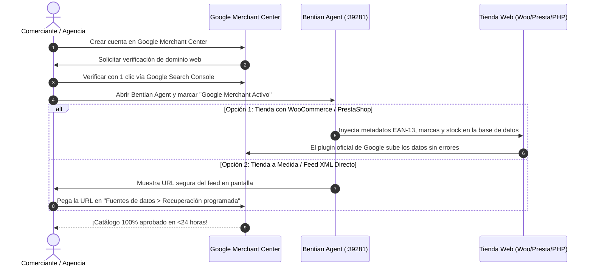

# Bentian ERP Bridge & Google Merchant Center: Especificación Modular
## Sección 5: Guía de Puesta en Marcha en 5 Minutos y Métricas de Rendimiento

> **ESTADO:** Aprobado / Especificación de Arquitectura Modular  
> **FECHA:** 31 de Octubre de 2026  
> **ÁMBITO:** Manual de Despliegue Rápido, Comercios, Agencias de Marketing, KPIs y ROAS  
> **UBICACIÓN MODULAR:** `docs/architecture/google-merchant/`

---

### 5.1. Guía Paso a Paso para Comerciantes y Agencias (5 Minutos)

El objetivo de Bentian es que un comerciante sin conocimientos técnicos de feeds ni programación pueda tener su catálogo publicado en Google Shopping y en las Fichas Gratuitas de Google en menos de 5 minutos:

---

### 5.2. Los 4 Pasos de Configuración Rápida

#### Paso 1: Reclamar y Verificar el Dominio en Google Merchant Center
1. Acceder a [merchants.google.com](https://merchants.google.com).
2. Introducir el nombre de la empresa y la URL de la tienda online (`https://www.tudominio.com`).
3. Para la verificación del dominio, Google ofrece vinculación instantánea si el usuario ya es propietario en **Google Search Console** (se verifica con 1 solo clic sin editar código).

#### Paso 2: Activar la Integración en Bentian Agent (`http://127.0.0.1:39281`)
1. Abrir la interfaz local de Bentian Agent en el PC de la tienda.
2. Ir a la pestaña **"Google Shopping / Merchant"**:
   * **Si utilizas WooCommerce o PrestaShop con el plugin oficial de Google:**
     - Simplemente marca la casilla: `[X] Sincronizar códigos EAN y marcas automáticamente con el plugin oficial`.
     - *¡Eso es todo! Bentian rellenará todos los datos en cada sincronización y Google los leerá directamente.*
   * **Si utilizas Feed XML directo:**
     - Haz clic en `[Copiar URL del Feed]`.
     - La URL tiene la estructura: `https://www.tudominio.com/erp-bridge-endpoint.php?action=google_merchant_feed&token=xxxxxx`.
     - En Google Merchant Center, ve a **Productos > Fuentes de datos > Añadir fuente de datos > Recuperación programada**, pega la URL y elige frecuencia diaria a las 06:00 AM.

#### Paso 3: Configurar Envíos y Políticas de Devolución
Google exige que los gastos de envío configurados en Merchant Center sean iguales o más baratos que los que se cobran en la web:
1. En Google Merchant Center, ir a **Envíos y devoluciones**.
2. Crear un servicio de envío para España (ej: *Península: 4,95 € o Gratis a partir de 50 €*).
3. Configurar la política de devoluciones estándar de la UE (mínimo legal de 14 días naturales de desistimiento).

#### Paso 4: Activar las Fichas Gratuitas de Google (*Free Listings*)
1. En el menú de Merchant Center, asegurarse de que el programa **"Fichas gratuitas de producto"** está marcado como **Activo**.
2. A partir de este momento, tus productos empezarán a aparecer gratis en la pestaña de Google Shopping, en Google Imágenes y en los resultados enriquecidos del buscador sin pagar publicidad.

---

### 5.3. Métricas de Rendimiento y Retorno de Inversión (KPIs)

Una vez activo, el comerciante y su agencia pueden auditar el rendimiento mediante cuatro métricas clave:

| Métrica / KPI | Objetivo con Bentian | Impacto Comercial Directo |
| :--- | :---: | :--- |
| **Tasa de Aprobación de Catálogo** | **> 98,5%** | Cero productos rechazados por falta de GTIN, precio o imagen. |
| **Tiempo de Detección de Rotura de Stock** | **< 5 segundos** | Eliminación del 100% de clics pagados en productos agotados físicamente. |
| **Clics Gratuitos (*Free Listings*)** | **+30% a +80%** | Tráfico orgánico de alta intención de compra sin coste por clic (CPC 0 €). |
| **Ahorro Directo en Herramientas de Feed** | **468 € a 2.148 € / año** | Sustituye herramientas SaaS de pago (Channable, Lengow, DataFeedWatch). |

---

### 5.4. Conexión con Google Ads (Campañas de Máximo Rendimiento / Performance Max)

Para empresas que deseen invertir en publicidad de pago en Google Ads:
1. Desde Google Merchant Center, ir a **Configuración > Cuentas vinculadas > Google Ads**.
2. Introducir el ID de cliente de Google Ads (formato `XXX-XXX-XXXX`).
3. Desde Google Ads, crear una campaña de **Performance Max (PMax)** seleccionando el feed de Merchant Center.
4. **Ventaja Competitiva Bentian en PMax:** Gracias a las etiquetas personalizadas generadas por Bentian (`custom_label_0` para margen comercial y `custom_label_1` para stock alto), la agencia puede pujar más fuerte por los artículos de mayor rentabilidad y excluir automáticamente los productos con pocas existencias.
